# Eight Switch KB DIY edition build guide

## materials

Your Eight-Switch KB DIY edition should have the following in the package:
1. 1 circuit board
1. 9 cherry style keyswitches (note: if you want to use another type of switch, now would be the time to switch them out)
1. 8 1u Keycaps
1. 1 1.5u Keycap
1. 8 resistors
1. 8 white LEDs
1. 1 Raspberry Pi Pico

You will also need:
1. A soldering iron
1. A spool of rosin-core solder (lead free is preferred and recommended for your safety, but leaded works better)
1. Some soldering flux (technically optional, but will make the soldering work better)
1. A helping-hands tool to keep your hands free while soldering
1. Side-cutters (to cut off excess leads)

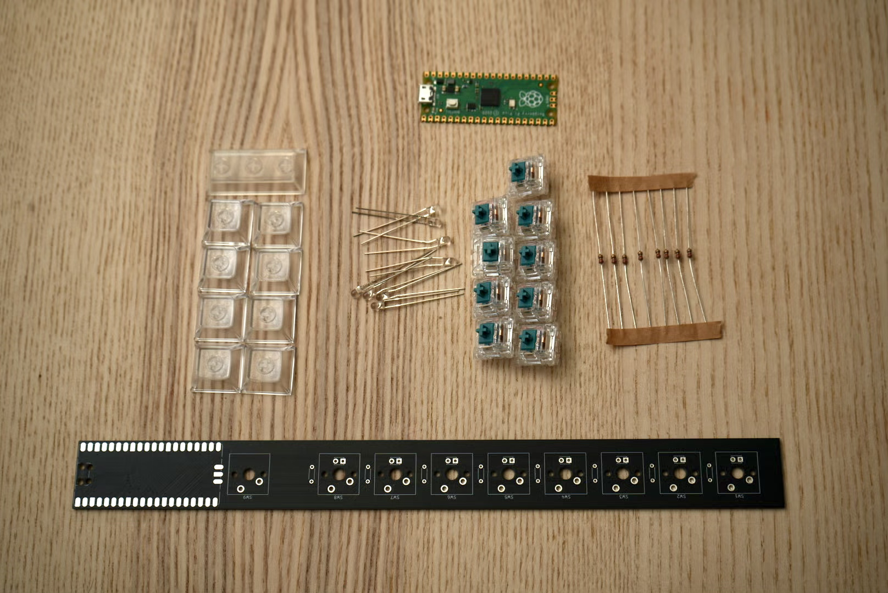
*The full kit, unassembled.*

## Assembly
You can put the different parts in and install them however you want, however, the order I've provided will make for the easiest assembly.

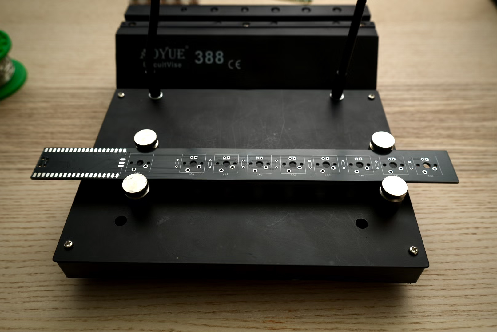
*The board placed and ready to start.*

1. Solder the Raspberry Pi Pico onto the circuit board
  1. place the raspberry pi pico on the pads for it with the micro USB connector facing out
    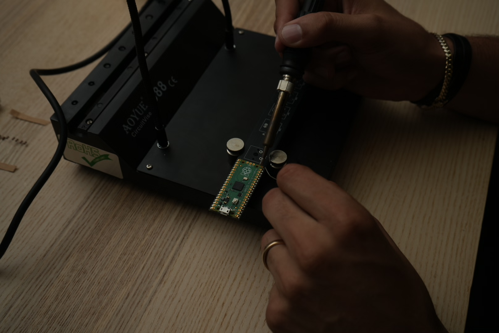
    *The Pico positioned at the end of the board before soldering.*
  2. Use your soldering iron to heat up the pad and the connection at the Raspberry pi pico at the same time
  3. slowly feed solder into the pad
    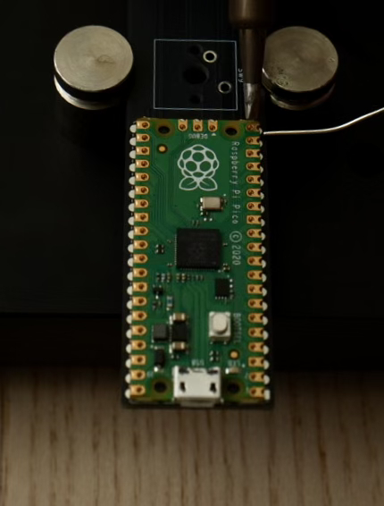
    *Heating a Pico pad and pin together.*
  3. Solder only one corner and re-do it until the raspberry pi pico lines up perfectly with the pads for it
    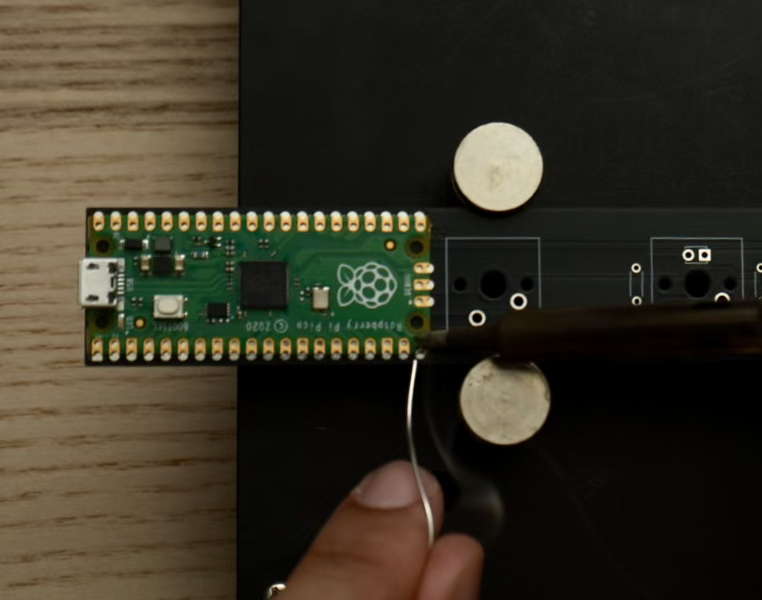
    *Feeding solder into a Pico pad.*
  4. repeat this process for the rest of the pads
    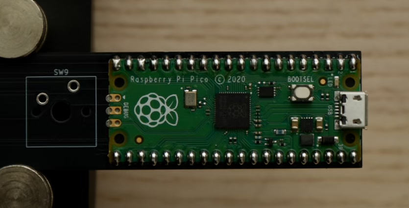
    *The Pico fully soldered onto the board.*

2. Solder the resistors onto the circuit board
  1. The resistor holes are the ones between the keyswitches.
  2. Place the resistor leads into the resistor holes.
    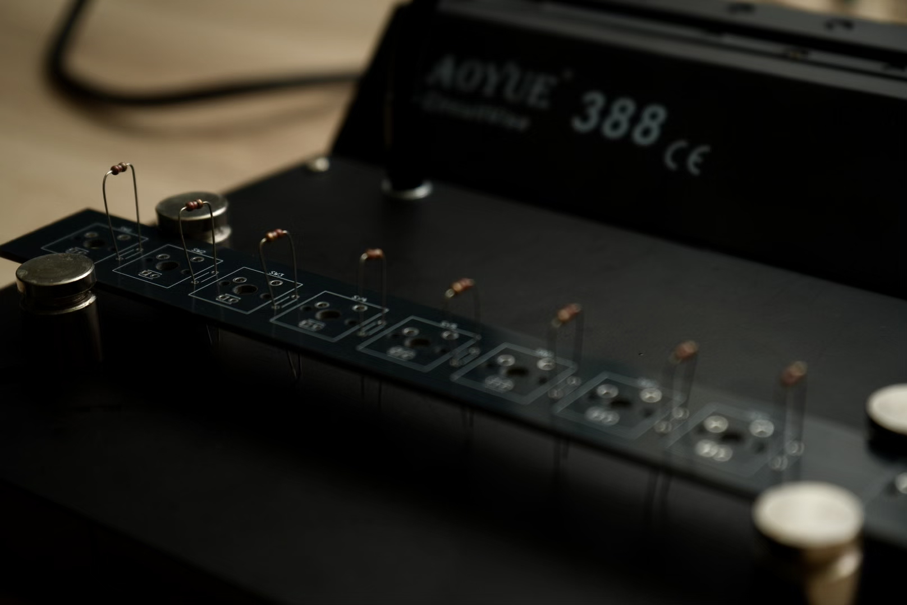
    *Resistors placed in their holes before soldering.*
  3. Bend the resistor leads down to hold the resistors in temporarily to work on the other side of the board.
    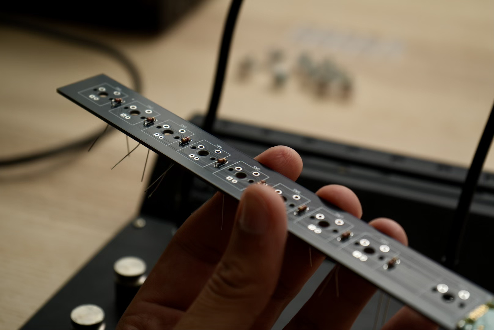
    *Board held up to check the resistor placement before flipping it to solder.*
  4. Use your hot soldering iron to heat up the resistor lead and the hole in the board at the same time.
  5. Slowly feed solder into the joint where the hole and the resistor lead meet.
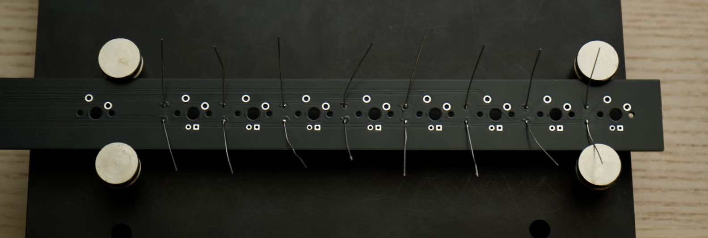
*Resistor leads soldered and trimmed flush.*

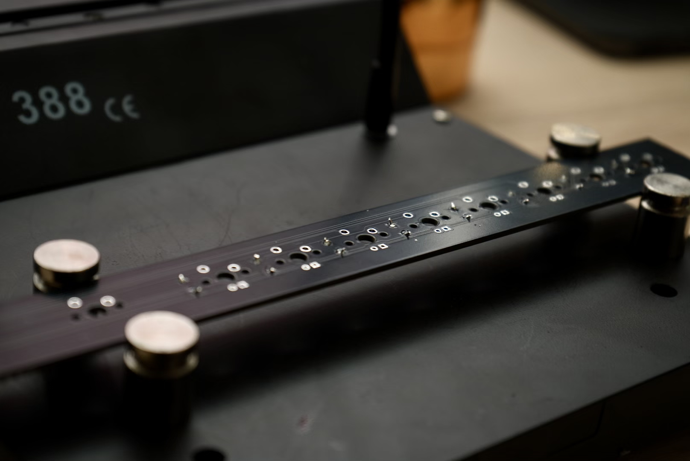
*A closer look at the trimmed resistor joints.*

3. Solder the keyswitches and LEDs onto the circuit board
  1. Put the LEDs through the slot in the keyswitch (as pictured)
  NOTE: The LEDs are polarized and must be placed in the correct direction. The long lead on the LED should go through the round plated hole in the circuit board. Look at the image for an example.
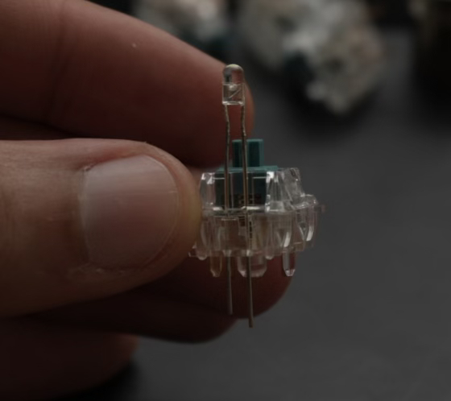
*An LED's leads threaded through the gap in a keyswitch housing, before being pushed down into the board.*
  2. place a keyswitch and LED into the holes for them, holding the LED AND switch at the same time to ensure they are flush to the board
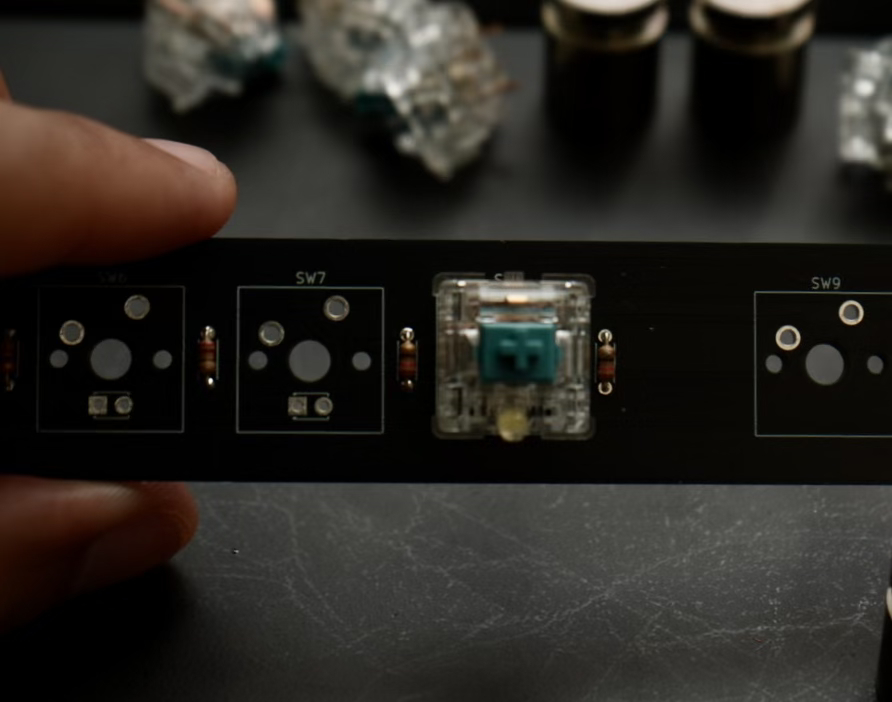
*LEDs seated under each keyswitch, board held toward the light so the domes are visible.*
  3. Solder the LED leads the same way you did the resistor leads
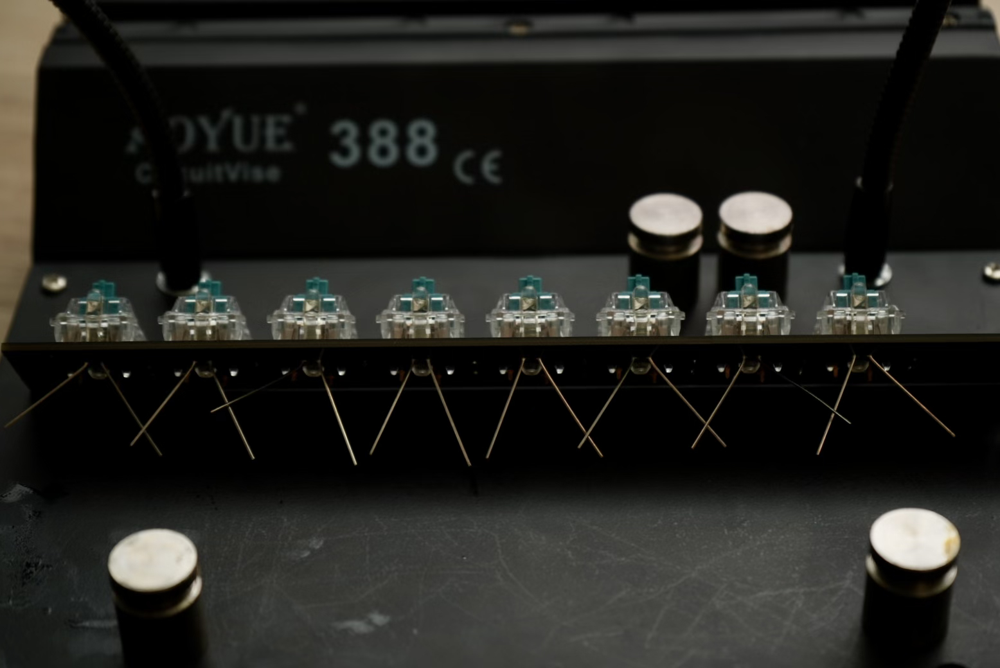
*LED and resistor leads splayed out on the underside of the board, ready to solder.*
  4. Solder the keyswitch lead the same way you did the resistor lead
  7. repeat this process until all 8 keyswitches with lights are soldered
4. Solder the last keyswitch (without LED)
5. Push the keycaps onto the keys

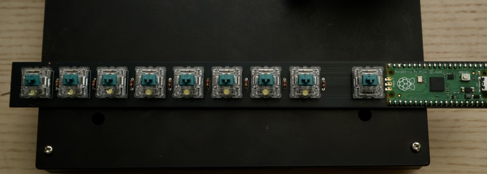
*Pushing the keycaps onto the keyswitches.*

6. Plug in your eight-switch Keyboard and try it out!

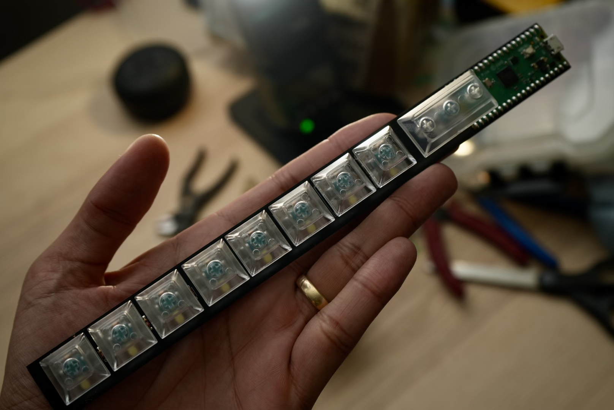
*The finished board.*

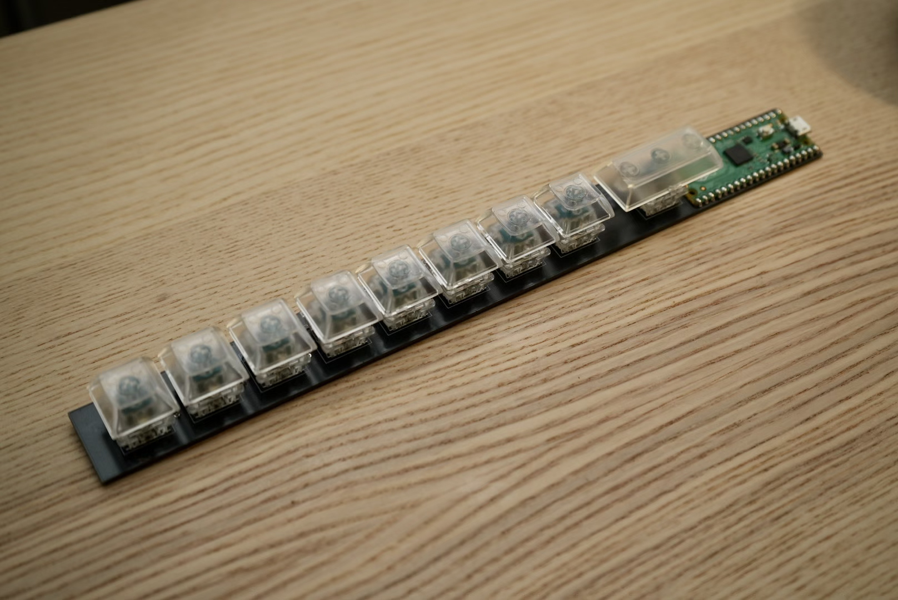
*The finished board, straight on.*
